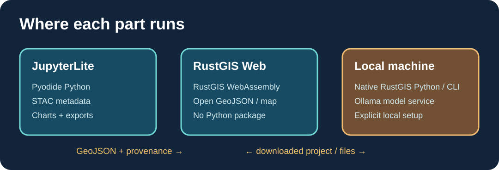

# AI assistance with Ollama

RustGIS has a native [AI Assistant](https://github.com/opengeos/RustGIS/blob/main/docs/user-guide/assistant.md) that can read the active map and run RustGIS commands. It supports a local Ollama provider. The assistant shows commands and results in its conversation; file, network, plugin, script, and project replacement actions ask for approval in RustGIS.

To try it, start Ollama on your machine and pull a model that handles tool calls. In native RustGIS, open **Analyze → AI Assistant**, select **Ollama**, and review each step. The upstream guide describes the default local address as `http://localhost:11434`. For RustGIS Web, the browser calls the local server directly and the guide instructs users to allow the web origin with `OLLAMA_ORIGINS=https://web.rustgis.app ollama serve`.

The same RustGIS assistant also documents Anthropic, OpenAI, Gemini, OpenRouter, and OpenAI-compatible providers. Choose based on where your prompts and any map rows read by the assistant may go.

[Notebook 07](https://jltobias.github.io/JupyterLite-RustGIS/lab/lab/index.html?path=07_ollama_assistance.ipynb) provides an authored example proposal and a validator. It does not send data to Ollama or execute generated commands. It helps learners distinguish an assistant's suggestion from an observed map result. For more Ollama teaching material, see the user's [GeoLibre–GeoAI notebooks](https://github.com/jltobias/JupyterLite-GeoLibre-GeoAI/tree/main/book/notebooks).
