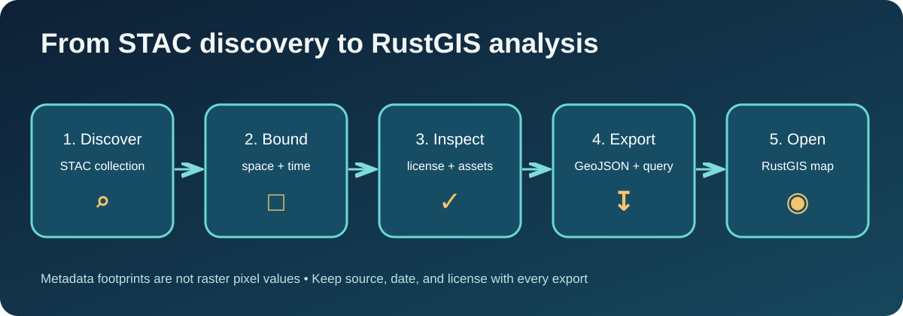

# JupyterLite–RustGIS

This book connects ten browser notebooks with STAC discovery, 2D maps, extruded 3D maps, a 3D scene, Ollama assisted planning, and the upstream RustGIS application. It uses a fictional teaching layer, a small WorldPop Degree of Urbanisation STAC metadata snapshot, and an attributed CMIP6 table from a sister repository. The teaching layer's heights are illustrative; the STAC footprints are not raster pixel values.

Start in the [JupyterLite Lab](https://jltobias.github.io/JupyterLite-RustGIS/lab/lab/index.html), then read the [workflow](workflow.md) and compare the [map views](maps.md). For direct RustGIS use, open the [official web app](https://web.rustgis.app/) or run the [native notebook](https://github.com/jltobias/JupyterLite-RustGIS/blob/main/notebooks/04_native_rustgis.ipynb) locally.

